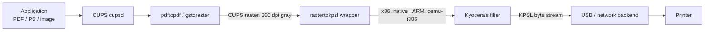

<div align="center">

# kyocera_drivers

[](https://github.com/e-gleba/kyocera-drivers/actions/workflows/package.yml)
[](https://github.com/e-gleba/kyocera-drivers/releases/latest)
[](https://github.com/e-gleba/kyocera-drivers)
[](https://github.com/e-gleba/kyocera-drivers)

[](https://github.com/e-gleba/kyocera-drivers/actions/workflows/package.yml)
[](https://github.com/e-gleba/kyocera-drivers/actions/workflows/release.yml)

Original PPDs and Kyocera's proprietary `rastertokpsl` filter for the 2012-era GDI printer family, packaged for modern Linux CUPS. No compiled code — CMake/CPack packaging plus a small Bash wrapper.

**Supported:** FS-1020MFP · FS-1025MFP · FS-1040 · FS-1060DN · FS-1120MFP · FS-1125MFP (GDI).

</div>

---

## Why this exists

The printers still work; their Linux support didn't survive:

- **The drivers are gone.** Kyocera moved to a universal driver and [no longer distributes](#notice) the per-model Linux packages — this repo bundles the originals and installs them where CUPS expects them.
- **The filter binary is x86-only.** Closed-source, shipped for i386/x86_64 only; ARM boards (Raspberry Pi, Orange Pi, …) cannot run it natively.
- **It crashes on non-ASCII job titles** (e.g. Cyrillic): the binary aborts mid-job and the printer hangs in "Processing" until a power cycle.
- **It predates modern CUPS filter plumbing.**

The bundled wrapper (installed as `rastertokpsl`) bridges all four:

- picks the right binary per machine — natively on x86, through `qemu-i386` on ARM;
- strips the job title to ASCII and forces `LC_ALL=C` — the crash-inducing bytes never reach the binary;
- resolves filters relative to its own location, so any install prefix works.

## Install

### One-shot (from a checkout)

[`scripts/setup.sh`](scripts/setup.sh) does everything — prerequisites (incl. the ARM QEMU runtime), build, install, CUPS restart, then a non-printing verification:

```bash
git clone https://github.com/e-gleba/kyocera-drivers.git
cd kyocera-drivers
sudo bash scripts/setup.sh
```

### Release packages

[e-gleba/kyocera-drivers/releases](https://github.com/e-gleba/kyocera-drivers/releases/latest) carry `.deb`, `.rpm` and `.tar.gz`:

```bash
sudo dpkg -i kyocera_drivers-*-Linux.deb   # Debian / Ubuntu
sudo rpm -i kyocera_drivers-*-Linux.rpm    # Fedora / ALT Linux
```

### Manual from source

Requires `cmake` ≥ 3.31 and `ninja`:

```bash
cmake --preset default
sudo cmake --install build/default --prefix=/usr
sudo systemctl restart cups
```

Then add the printer at <http://localhost:631> and pick the PPD matching your exact model.

## Verify without printing

[`scripts/verify.sh`](scripts/verify.sh) runs a sample page through the real chain — PPD raster format → `rastertokpsl` → KPSL — and asserts the output. Nothing is sent to the printer:

```bash
bash scripts/verify.sh                          # from a checkout
bash /usr/share/doc/kyocera_drivers/verify.sh   # from a release package
```

It ends with e.g. `OK: armv7l produced 4 KB of KPSL — nothing sent to the printer`.

## ARM boards (Raspberry Pi, Orange Pi, …)

`scripts/setup.sh` covers it; under the hood it installs the QEMU i386 runtime:

```bash
sudo dpkg --add-architecture i386
sudo apt update
sudo apt install qemu-user-static libc6:i386 libcups2:i386 libcupsimage2:i386
sudo ln -sf /lib/i386-linux-gnu/ld-linux.so.2 /lib/ld-linux.so.2
```

Cost: a page rasterizes in ~2–3 s on an Orange Pi PC. aarch64 boards use the same commands.

## Uninstall

```bash
sudo xargs rm -f < build/default/install_manifest.txt   # installed from source
sudo dpkg -r kyocera_drivers                            # installed from .deb
sudo rpm -e kyocera_drivers                             # installed from .rpm
```

## How it works



## Troubleshooting

| Symptom | Fix |
|---|---|
| `No such preset "default"` | CMake ≥ 3.31 required — check `cmake --version`. |
| Filter stops with status 127, or `No such file or directory` in `error_log` | Stale/partial install. `sudo rm -f /usr/lib/cups/filter/rastertokpsl* /usr/local/lib/cups/filter/rastertokpsl*` and reinstall. |
| `wrapper.sh: QEMU i386 runtime incomplete` | ARM host missing the QEMU prerequisites — run `scripts/setup.sh`. |
| `wrapper.sh: unsupported architecture` | Host outside x86/ARM — open an issue with `uname -m`. |
| Filter errors at runtime | `sudo tail -f /var/log/cups/error_log`; add `sudo cupsctl --debug-logging` for full detail. |
| Wrong page size or orientation | Selected PPD does not match the exact printer model. |

## Known upstream problems

These live in the external stack (Kyocera's binary, CUPS defaults, libcupsfilters) — **not** in this packaging layer. Enable debug logging first; the log names the exact filter that fails:

```bash
sudo cupsctl --debug-logging && sudo systemctl restart cups
sudo tail -F /var/log/cups/error_log | grep --line-buffered -E '\[Job'
```

### 1. Printer hangs mid-job until a power cycle — non-ASCII job titles

Kyocera's binary aborts (SIGABRT/SIGSEGV) when the title or username contains non-ASCII bytes (e.g. Cyrillic on `ru_RU.UTF-8`); the printer receives a partial KPSL stream and waits forever. Windows is unaffected (different driver codebase).

```bash
lp -d <queue> -t "тест" /usr/share/cups/data/testprint    # reproduce
sudo grep -E 'crashed|signal' /var/log/cups/error_log      # confirm
```

**Mitigated by the bundled wrapper**: titles are stripped to ASCII and `LC_ALL=C` is forced, so the crashing bytes never reach the binary. The bug itself is Kyocera's.

References: [OpenPrinting/cups#966](https://github.com/OpenPrinting/cups/issues/966) · [Arch forums — FS-1061DN filter crash](https://bbs.archlinux.org/viewtopic.php?id=272961)

### 2. Queue shows "stopped" after any failed job

CUPS' default `stop-printer` error policy halts the whole queue on one failed filter; later jobs pile up behind it.

```bash
lpstat -p <queue>                                            # check
sudo lpadmin -p <queue> -o printer-error-policy=abort-job    # fix
```

### 3. Every job fails with "Unexpected page count"

libcupsfilters 2.2.1 (pdfio-based page counting) misreads its own intermediate PDF and aborts **every** job — affecting all `*cupsFilter` drivers, not just Kyocera. Fixed upstream by [libcupsfilters PR #167](https://github.com/OpenPrinting/libcupsfilters/pull/167).

```bash
sudo grep -E 'Missing Root object|Unexpected page count' /var/log/cups/error_log
```

**Fix:** update libcupsfilters past the fix, or pin 2.1.1 (qpdf-based).

---

## Notice

Kyocera no longer maintains legacy per-model Linux drivers ([universal print](https://www.kyoceradocumentsolutions.com/support/universal_print/), [global portal](https://global.kyocera.com/support/download/)). The PPDs in `ppd/English/` come from the [OpenPrinting archive](https://www.openprinting.org/download/PPD/Kyocera/en/); automated fetching is disabled by default (`DOWNLOAD_PPDS=OFF`).

---

<div align="center">

[CMake Presets](https://cmake.org/cmake/help/latest/manual/cmake-presets.7.html) · [CPack](https://cmake.org/cmake/help/latest/module/CPack.html) · [SDB: Custom CUPS Filters](https://en.opensuse.org/SDB:Using_Your_Own_Filters_to_Print_with_CUPS)

GPL-3.0 — see [license](license).

</div>
